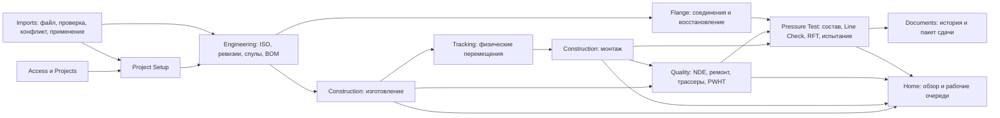

# PipeQC: аудит дизайна и роадмап продолжения

Дата: 14 октября 2026. Статус: предложение, реализация не начата.

## Главный вывод

PipeQC уже содержит работающие предметные модули, а не только оболочку демо. Продолжать его стоит через исправление связей между инженерной ревизией, выполненными работами, контролем качества и готовностью тест-пакета. Сейчас самая дорогая сложность находится именно на этих границах: разные определения готовности, неполный перенос доказательств, отдельные правила доступа внутри RPC, сборка состояния объекта в браузере.

Приоритет: **доступ и достоверность исходных фактов → ревизии и сохранность работ → единая готовность → выборочный NDE → недостающие рабочие операции и импорты → документы сдачи → масштаб и пилот**. Развивать отчёты, графики и новые формы до исправления основы означает распространять спорные данные ещё на несколько поверхностей.

По принципам *A Philosophy of Software Design* текущая оценка дизайна — **6/10**. Это экспертная оценка понятности и изменяемости архитектуры, не процент готовности продукта и не оценка соответствия отраслевым нормам. Сильная база уже есть: транзакционные SQL-команды, события прогресса, независимые области доступа, справочники, единый реестр навигации и локализация. До 10/10 нужны один владелец каждого правила, атомарная смена ревизии, простые типизированные чтения, достоверная история и воспроизводимая проверка стыков модулей.

## Что исследовано и что проверено

Исследованы исходный [Easy Piping User Manual](../Easy%20Piping%20User%20Manual.pdf), версия 4.7.3, 156 страниц, и его [текстовое извлечение](../marker-output/manual.md). Сопоставлены разделы 1–20 с маршрутами, моделями, приложением, репозиториями, последними определениями SQL и тестами. Таблицы на страницах 49 и 143 дополнительно просмотрены в оригинальном PDF: перенос неизменённых работ и граница состава тест-пакета подтверждаются самим документом.

Объём текущей структуры: 12 каталогов предметных модулей, 214 файлов `.ts/.tsx` без тестов в `modules/`, 70 `page.tsx`, 112 миграций и 58 файлов DB-тестов. Это инвентаризация исходников, а не снимок установленной БД. Для SQL учитывались переопределения функций и views в более поздних миграциях; старые определения не принимались за актуальные.

Свежие проверки этого аудита:

| Проверка | Результат | Что доказывает |
|---|---|---|
| `npm run typecheck` | Без диагностик TypeScript | Текущий код согласован по типам |
| `npm run test:unit` | 692 passed, 0 failed, 0 skipped | Проходят существующие unit-проверки, включая EN/RU |
| `npm run lint` | 0 errors, 157 warnings | Нет ошибок линтера; предупреждения остаются |
| Локальный runtime | `localhost:3000` недоступен; контейнеры локального PipeQC Supabase не запущены | В этом аудите нет живой приёмки UI/БД |

Предупреждения lint: 77 `no-explicit-any`, 42 `set-state-in-effect`, 37 `exhaustive-deps`, 1 `no-anonymous-default-export`.

`test:db`, полный `verify`, браузерный проход и hosted-стенд не проверялись. База не сбрасывалась, фикстуры не загружались. Исторические результаты в [UPG dry run](../acceptance/2026-10-09-upg-dry-run.md) использованы для поиска сценариев, затем сопоставлены с текущим кодом; они не объявляются свежим runtime-доказательством. Исходный код не изменялся; добавлен только этот документ.

Ниже «подтверждено кодом» означает установленное свойство реализации. «Вывод из кода» — ожидаемый результат конкретного сценария, которому ещё нужен прогон БД. «Решение scope» — расхождение с мануалом, которое может быть допустимым ограничением продукта, но должно быть явно принято.

## Карта модулей и их границ

Это схема зависимостей данных, не обязательный порядок всей стройки. Тест-пакеты можно собирать заранее; NDE обслуживает и цех, и монтаж; физическое местоположение не заменяет факт завершения работ.

| Модуль | Что уже существует | Где продолжать | Дизайн сейчас |
|---|---|---|---|
| `access` | Membership, функциональные роли, capability, PDS/subcontractor scope, управление доступом | Закрыть обходы через definer RPC; проверить grants на свежей установке и прямые вызовы команд | 6/10 |
| `projects` | Каталог проектов, метаданные, выбор проекта и привязка к URL | Приёмка переключения проекта, обновления прав и недоступных прямых ссылок | 8/10 |
| `project-setup` | Системные/проектные справочники, readiness, веса, WPS, сварщики, PML, команды, география, устройства | Полный путь настройки пустого проекта; согласовать Excel и ручной ввод; уменьшить связанность больших форм | 7/10 |
| `imports` | 8 Excel/text типов, durable jobs, ошибки, конфликты, validate/apply | Даты и флаги качества; массовые работы и результаты NDE; не создавать отдельное правило для Excel | 7/10 |
| `engineering` | Реальный SpoolGen parser, четыре роли файлов, validation, preview, ревизии, browse/history, manual revision RPC | Полный и атомарный перенос работ; сравнение старого и нового; последствие ревизии для пакетов | 5/10 |
| `construction`: изготовление | Workbench, BOM→PML trace, сварка/WPS/points, опоры, PWHT, QC Release, paint/DFT, Final QC, laydown; сохранённая проекция | Развести факт работы, eligibility и выпуск; убрать копии QC-правил в TS; сохранить факты при R1 | 6/10 |
| `construction`: монтаж | Workbench, To Site, материал, field weld/support, stage events, RFT, графики | Условия дат и завершения деталей; история опор; согласовать готовность спула и ISO | 5/10 |
| `quality` | Обязательства, партии, candidates, выдача, результаты, repair/tracer, escalation, dashboards | Законченный spot-процесс по мануалу; доступ к candidates; повторы команд; отдельное требование клиента | 5/10 |
| `tracking` | IN/OUT ledger, места, transit alerts, inconsistencies, устройства, Excel barcode list, импорт сканов и три выгрузки для PDA | Полнота больших выборок; сверка логистики с работами; понятное исправление события | 7/10 |
| `flange` | Worklist/history, 1–2 jointer, category/torquing, UT, прогресс, copies, Y/Z reinstatement | Граница связи с test pack; раскрытие истории и статуса ревизии; round-trip импорта | 7/10 |
| `pressure-test` | Builder/import, ISO membership, Line Check/X, clearance, blinding, три даты тестирования/precomm, Y/Z, print URLs, explorer | Исправить RFT, закрепить состав, основания и переходы; упростить загрузку; решить spool membership и punch X/Y/Z | 5/10 |
| `documents` | Два реальных экспорта: fabrication XLSX и Test Pack RFT PDF | Документы работ, weld/NDE history, комплект сдачи, воспроизводимый снимок и локализация файлов | 7/10 |
| `home` | Process map, сводки fabrication/erection/NDE/TP | Очередь конкретных блокеров и ответственных; сводки из тех же правил, что объект | 7/10 |
| Shell и i18n | Общий registry, контекст спула/пакета, URL, tabs/rail, unsaved guard, EN/RU и glossary | Проверить async ownership и возврат из блокера; привести локализованные сообщения к устойчивым смысловым ключам | 8/10 |

Оценка Documents относится к простоте существующего небольшого интерфейса; его функциональное покрытие пока узкое. Отсутствие большого числа отчётов само по себе не означает плохую архитектуру.

## Сверка с исходным мануалом

| Раздел мануала | Текущее покрытие | Разрыв / решение |
|---|---|---|
| §1 Project Definition | Проекты, основные параметры, branding, определения custom fields | Проверить применение custom fields в работах, импортах и отчётах; определение поля не равно работающему сценарию |
| §2 System Referential | Material types, film quantity, UT, torquing | Сохранить ограничения статических справочников и корректное использование downstream |
| §3 Project Referential | Широкий набор справочников и readiness | Импорт WPS/сварщиков/NDE неполон; pressure unit, RAL, paint matrix требуют отдельной проверки создания через UI |
| §4 Access | Более сильная модель через capabilities/RLS вместо dropdown-фильтров | Закрыть RPC-обходы и проверить scope по всем путям |
| §5 Import Settings | PML, WPS, сварщики, thickness, NDE | PWHT/material traceability и даты не покрыты текущим Excel-контрактом; проверить нужду в остальных импортируемых справочниках |
| §6 Spooling | Parser, validation, preview, решения ревизии, история, manual revision backend | Перенос `done_without_modification` неполон; Marian availability отсутствует в текущем наборе импортов; engineering transmittals/ISO workflow/spooling transmittal остаются placeholders |
| §7 Fabrication | Почти вся цепочка операций имеет формы и серверные команды | `Fabricated` у нас вычисляется; мануал описывает dimensional check и подтверждения. Нужен явный вердикт о достаточности такого упрощения. QC-13 request не равен готовому бланку |
| §8 Import Progress | Отдельных типов для shop/site/weld progress и spool custom categories нет | Ввести по подтверждённой потребности, через существующие команды и журнал исправлений |
| §9 Fabrication Reports | Есть XLSX по сварочным фактам | Weekly/cumulative/summary и формы работ не реализованы как полный набор мануала |
| §10 Tracking | Основные read models, alerts, imports, barcode Excel и PDA dump | Это файловый обмен с PDA; offline PWA/mobile-приложение — отдельное расширение, не автоматическое требование мануала |
| §11 NDE | Существенная реализация обязательств, партий, results и repair/tracer | Spot population/release, автоматическое формирование партий, client-requested examination, импорт результатов и отчёты требуют доделки |
| §12 Erection | Основные операции представлены | Field completion и RFT не согласованы на всех уровнях; W-24 и подготовка фронта работ неполны |
| §13 Erection Reports | Графики есть, выделенного комплекта экспортов нет | Weekly и progress exports должны читать те же факты |
| §14–15 Test Pack | Builder, definition, imports, состав и история изменений | Состав моделируется целыми ISO. Мануал §18.6 требует расчёт по спулам, реально включённым в выбранный пакет |
| §16 Pressure Test | Подготовка/прогресс, X clearance, blinding, три даты, Y/Z flange reinstatement | Line Check punch items ограничены X; начало тестирования обходится без blinding. По §16.7 мануал ведёт даты, не фактические параметры испытания |
| §17 Home Page | Есть overview и рабочие поверхности | Ready/ongoing должны строиться из единой eligibility, с переходом к конкретному действию |
| §18 Explorer | Иерархия и readiness views существуют | Ошибки агрегирования и даты; происхождение основания, состав и ревизии; корректные переходы от каждого blocker |
| §19 Flange | Значительная реализация прогресса, history, imports, UT и copies | Проверить manual revision UI и границу выбранного пакета; категории фланца нельзя смешивать с замечаниями Line Check |
| §20 Test Pack Reports | Есть RFT PDF | Нет полного weld history и system/testpack summary/detail пакета |

Не следует переносить из мануала интерфейс 2014 года или hard-delete производственных данных. Его ценность здесь — правила, сущности, основания, результаты и ответственность. Графики, custom stages, Marian и transmittals имеют разные причины существования; их нельзя объявлять обязательным следующим этапом только потому, что в старом продукте они были.

## Подтверждённые проблемы и сценарии для воспроизведения

### F01. Чтение NDE candidates обходит единую границу доступа — P0

**Подтверждено кодом.** Последняя `nde_batch_candidates(uuid)` объявлена `SECURITY DEFINER`, находит batch по переданному ID и возвращает кандидатов его проекта. В теле нет проверки capability, membership или PDS/subcontractor scope. Предыдущая миграция даёт `EXECUTE` роли `authenticated`; последующее `CREATE OR REPLACE` сохраняет существующий grant.

Источники: [последнее определение](../../supabase/migrations/20260809090000_nde_coverage_regime.sql#L267), [grant](../../supabase/migrations/20260808090000_track06_corrections.sql#L695), [UI caller](../../modules/quality/infrastructure/supabase-quality-repository.ts).

**Вывод из кода:** зная UUID чужой партии, authenticated пользователь может получить IDs обязательств, номера стыков и даты без обычных RLS-фильтров. Это ещё не воспроизведение на установленном стенде. Воспроизвести с двумя проектами и scoped пользователем; закрывать чтение через security-invoker projection и политики, а не добавлением ещё одной независимо поддерживаемой проверки в UI.

Также требуется свежая проверка дефолтных grants: старый [список сбоев pgTAP](../../tasks/material-check/pgtap-known-failures.txt) и [аудит](2026-10-06-backend-simplification.md) описывают внутренние helpers и защищённые колонки. Точное текущее количество ошибок без БД неизвестно. Один `revoke` в октябрьской миграции не доказывает закрытие всех классов.

### F02. Excel-импорт создаёт даты квалификации, которых не было во входе — P0

**Подтверждено кодом.** В [спецификации импортов](../../modules/imports/domain/import-types.json) у WPS нет `approved_on`, у сварщиков нет `expires_on`. Последний [apply_import_job](../../supabase/migrations/20261009180000_welder_import_apply_fix.sql#L125) подставляет WPS сегодняшнюю дату утверждения, а сварщику срок действия через год. Это две разные проблемы: историческая сварка отклоняется из-за искусственно позднего WPS; неизвестная квалификация может считаться действующей благодаря искусственному сроку.

**Решение:** требовать реальные даты/подтверждённые сведения, одинаковые для формы и Excel. Не назначать «валиден год» при отсутствии данных. Проверить new/import/update и пересчёт eligibility. Существующие импортированные записи нельзя автоматически признать достоверными после исправления parser — нужен список записей для сверки с источником.

### F03. ISO/Test Pack RFT может не зависеть от завершения монтажа — P0

**Подтверждено кодом.** [isometric_readiness](../../supabase/migrations/20260813094000_test_pack_readiness.sql#L3) считает `spool_complete` через erection RFT, но не использует этот счётчик в `is_complete` и `is_rft`. Welding/support counters берёт из fabrication view. Поэтому законченный цех и выполненный Line Check способны дать зелёный ISO при незавершённых field-операциях.

На уровне спула [spool_erection_readiness](../../supabase/migrations/20260811090000_erection_readiness_material_naming.sql#L20) требует даты `welded_bolted`/`supported`, NDE/PWHT, но не равенство счётчиков field weld/support. [record_erection_progress](../../supabase/migrations/20260810093000_erection_progress_commands.sql#L3) позволяет записать эти даты после предыдущих стадий без проверки детализации работ. Графики повторяют формулу в [сохранённой проекции](../../supabase/migrations/20260818105000_erection_projection_charts.sql).

**Решение:** согласовать контракт `shop completion`, `site completion`, `QC eligibility/clearance`, `ISO RFT`, `pack RFT`. Дата этапа и доказательство завершения всех деталей должны иметь понятную связь. Одно серверное вычисление должно отдавать статус и причины всем потребителям.

В pack aggregate дополнительно проверить `member_count = current_member_count`, отсутствующий accepted revision и дату RFT: сейчас aggregate фильтрует отсутствующие readiness строки и использует `min(readiness.rft_on)`. Для даты готовности всего пакета обычно нужен последний момент выполнения всех критериев; это следует подтвердить определением бизнеса, а не заменить `min` механически.

### F04. Монтаж опоры может уничтожить цеховой факт — P0

**Подтверждено кодом.** [record_field_support_progress](../../supabase/migrations/20260810093000_erection_progress_commands.sql#L343) делает `ON CONFLICT (support_revision_id) DO UPDATE`, заменяя `phase` и `installed_on`. Одна запись используется обеими фазами. Этот же сценарий зафиксирован как F5 в UPG dry run.

**Решение:** сначала определить, что относится к shop installation, field installation и field verification; затем сохранять независимые нужные факты и их историю. Простое добавление phase в unique key без этой договорённости может заставить «устанавливать» каждую опору дважды. После исправления оба read model должны сохранять достоверные значения; восстановление старых дат из audit требует отдельной сверки.

### F05. `testing_started` допускается без blinding и без RFT — P0

**Подтверждено кодом.** [record_pressure_test_stage](../../supabase/migrations/20260814101000_track10_browser_gate_fixes.sql#L42) проверяет наличие blinding только для стадий, отличных от `testing_started`; RFT здесь не проверяется. Клиентская [машина состояний](../../modules/pressure-test/domain/pressure-test-workflow.ts) разрешает начало только из `blinded`, то есть контракт UI и SQL расходится.

**Решение:** серверная eligibility для начала с reason codes. Сначала зафиксировать, является ли команда подтверждением реального начала испытания или лишь импортом плановой/исторической даты; разные смыслы не должны использовать один незаметно ослабленный переход. Мануал §16.7 описывает ввод фактических дат. Проверять прямой RPC, а не только disabled кнопку.

### F06. «Без изменений» переносит только часть работ, отдельным вызовом клиента — P1

**Подтверждено кодом и исходным PDF.** Мануал, стр. 49, отличает `done_without_modification` от `rework`: неизменённый спул и его сварка сохраняют прогресс; для rework выборочный перенос ограничен. У нас [ProgressKind](../../modules/engineering/domain/revision.ts) содержит только `fabrication_start`, `sent_to_paint`, `paint` для обоих решений. [materialize_progress_copies](../../supabase/migrations/20260804090000_fabrication_progress.sql#L244) материализует только эти события.

После применения revision [RevisionWorkbench](../../modules/engineering/ui/revision-workbench.tsx#L92) отдельным RPC переносит progress. Он использует fabrication capability; импортёр может успешно принять R1 и получить warning о неперенесённых работах. Скриптам приходится знать тот же дополнительный шаг. Это классический случай temporal decomposition и утечки знания между Engineering, Construction и callers.

**Решение:** единая серверная операция принятия ревизии с понятным результатом. Определить матрицу переноса BOM trace, weld/points, support, quality evidence, painting, erection и flange. Для изменённых объектов не переносить основания автоматически. NDE/PWHT не копировать просто как зелёные флаги: сохранить происхождение и правила применимости. Если часть процесса выполняется отложенно, это должно быть явное durable состояние, закрывающее downstream eligibility, с серверным восстановлением.

### F07. Повтор команды может отказать после успешного выполнения — P1

**Подтверждено кодом.** `allocate_nde_batch_candidates`, `issue_nde_batch`, `close_nde_batch` проверяют новый статус до completed receipt. Последний [record_nde_result](../../supabase/migrations/20260809092000_nde_repair_supersedes_parent.sql#L153) проверяет disposition/существующий result раньше receipt. Повтор уже выполненного запроса способен дать PQC41/PQC42 вместо сохранённого результата.

[claim_command_receipt](../../supabase/migrations/20260804090000_fabrication_progress.sql#L59) не сравнивает payload; ключ optional. В [NDE UI](../../modules/quality/ui/nde-batch-screen.tsx) создаётся новый UUID при каждом вызове обработчика, поэтому receipt сам по себе не обеспечивает восстановление одной попытки после потери ответа.

**Решение:** один контракт command receipt, включающий цель и согласованный fingerprint нормализованных данных. Проверку личности/доступа сохранить до выдачи сохранённого результата; проверки изменившихся предусловий — после проверки receipt. Клиент сохраняет ключ до определённого исхода попытки. Tracking уже имеет более строгий контракт событий устройств; его нельзя ослаблять ради унификации.

### F08. Spot NDE выглядит как выбор процента кандидатов, а не завершённый контроль партии — P1

**Подтверждено кодом:** генератор создаёт обязательства на сваренные стыки; allocation берёт долю pending candidates по параметру пользователя; `record_nde_result` удовлетворяет выбранное обязательство; `close_nde_batch` проверяет наличие результатов у включённых позиций. В этих последних определениях нет перехода, освобождающего неизбранную часть закрытой spot population. Interim waiver RPC [удалён](../../supabase/migrations/20260807095000_retire_interim_nde_outcome_rpc.sql).

**Вывод из кода для воспроизведения:** при 10 стыках, правиле 10% и одном принятом образце остальные обязательства могут остаться pending и блокировать QC, хотя выборочная партия закончена. Манул §11.1–11.2 описывает population, выбор образца, выпуск остальных и расширение при браке. Наличие repair/tracer SQL ещё не доказывает реализацию всей этой семантики.

Также последняя `nde_batch_candidates` группирует по method/regime и optional welder, без фильтра weld location или конкретного процента матрицы; spot batch может быть без welder. Проверить, какие границы партии обязательны для проекта. Не подменять процент контроля процентом текущей загрузки партии.

### F09. Неполный Excel-контракт NDE и неполный путь настройки — P1

**Подтверждено кодом.** NDE Excel type и [последний apply](../../supabase/migrations/20261009180000_welder_import_apply_fix.sql#L91) не переносят PWHT/threshold/material traceability, хотя ручной [NDE reference input](../../modules/project-setup/domain/welding-quality-reference.ts) поддерживает эти параметры. При create импортируемое правило получает defaults; при update часть старых параметров остаётся. Ручной и Excel пути имеют разные возможности.

Для настройки не повторять старый список отсутствующих форм: текущий [TestpackReferences](../../modules/project-setup/ui/testpack-references.tsx) уже содержит создание line services. Но pressure unit здесь только отображается; [SpoolingReferences](../../modules/project-setup/ui/spooling-references.tsx) показывает RAL и paint matrix без соответствующих create/edit форм. Нужно проверить пустой проект целиком и закрыть только необходимые рабочие настройки. Setup readiness должен проверять покрытие реальных входных данных, а не одно наличие любой WPS/NDE/PML строки.

### F10. Состав и основания тест-пакета имеют слишком крупную границу — P1 / решение scope

**Подтверждено кодом и PDF.** [test_pack_isometrics](../../supabase/migrations/20260813091000_test_pack_core.sql#L38) связывает пакет с ISO; уникальность запрещает одной ISO состоять в двух активных пакетах. Builder оперирует ISO. Между тем мануал §18.6, стр. 143, явно ограничивает расчёт спулами, реально принадлежащими выбранному пакету.

Если пилот допускает только целые ISO, это можно оставить как явное ограничение. Если контур пересекает часть ISO, нужен состав на уровне выбранных спулов/элементов; простое добавление нового фильтра в UI проблему не решит.

Чтение готовности использует новую accepted revision, а line-check facts группирует по стабильному ISO, без привязки к инженерной ревизии. Это отдельный риск применимости старого обхода после изменения R1. Существующий DB-тест проверяет случай пустой R1, но не всю матрицу переноса и повторного допуска. Нужны сценарии R1 после Line Check, после blinding и после тестирования.

### F11. Назначение Line Check не проверяет все предметные предусловия — P1

**Подтверждено кодом.** Последний [assign_line_check](../../supabase/migrations/20260813093000_line_check_punch.sql#L105) проверяет accepted ISO, scope, team и повторное назначение, но не завершённость welding/support и принадлежность выбранной ISO составу указанного pack. Мануал §16.1 описывает готовый к обходу фронт работ. В [record_line_check_result](../../supabase/migrations/20260814101000_track10_browser_gate_fixes.sql#L3) переданный spool проверяется на принадлежность проекту, но не на соответствие выбранной ISO.

**Решение:** команды выводят нужные связи из IDs и проверяют состав/готовность на сервере. Отдельно разрешить или запретить предварительное плановое назначение; планирование и факт готовности к выполнению не должны сливаться. В сценариях проверить ISO вне пакета и spool другой ISO того же проекта.

### F12. Общий рабочий объект собирается множеством несогласованных чтений — P2

[TestPackWorkspaceLoader](../../modules/pressure-test/ui/test-pack-workspace-loader.ts) сначала читает pack, затем 15 запросов параллельно и затем effective reinstatement records. Часть функций внутри добавляет повторное чтение members, JOIN в JS и chunking по 50 IDs. Это больше, чем «один экран читает 14 запросов» из старого аудита. Находящийся здесь `readCompleteScopedRows` сейчас вызывается только тестами, поэтому его проверки count/усечения не защищают реальные worklists. Даже применение такого helper не обеспечило бы единый снимок нескольких чтений.

UI [workflow model](../../modules/pressure-test/ui/test-pack-workflow-model.ts) снова вычисляет eligibility Y/Z и стадии из строк; QC Release и RFT имеют другие копии правил. При этом некоторые доменные readiness-функции используются только тестами, не приложением: их зелёные тесты не доказывают SQL-правило.

**Решение:** узкие invoker projections для overview, readiness/blockers и операций. Тяжёлую детализацию читать при открытии соответствующей области. Сохранить существующую защиту ownership/stale loads и отказ операций при неактуальном снимке. Не заменять всё одним гигантским JSON RPC.

### F13. Есть риск тихого усечения project-wide списков и экспортов — P2

В [Supabase config](../../supabase/config.toml#L18) `max_rows = 1000`. [NDE loader/KPI](../../modules/quality/infrastructure/supabase-quality-repository.ts) читает project-wide rows без полного обхода; KPI запрашивает exact count, но считает `rows.length`. Аналогичные границы требуют проверки для engineering browse, tracking и [report snapshots](../../modules/documents/infrastructure/supabase-report-repository.ts).

Это не измеренная деградация производительности. Ограничение и способ чтения подтверждены кодом, фактическое усечение требует набора >1000 записей. Правило «без пагинации для одного объекта» не означает «одна неограниченная выгрузка всего проекта». Нужно доказать полноту counts/exports отдельно от UI-пагинации.

### F14. История пишется, но ещё не превращена в проверяемый результат — P1/P2

Команды пишут `audit_events`, но в текущих modules/app нет поверхности чтения этого журнала. Есть только [два report definitions](../../modules/documents/domain/report.ts), browser-generated файлы и отдельные print routes запросов. Нет воспроизводимого комплекта истории спула/тест-пакета, который сохраняет состав, ревизии и основания на момент сдачи.

Выходные XLSX/PDF пока используют английские литералы в [renderers](../../modules/documents/infrastructure/renderers/), хотя UI переводится. Значит, зелёная EN/RU проверка экранов не доказывает локализацию экспортов. Нужны отдельные ограничения формата, шрифтов, дат, единиц и длинных строк.

## Какие ограничения продукта нужно решить до расширения

| Вопрос | Рекомендация для ближайшего этапа | Почему нельзя решить незаметно в коде |
|---|---|---|
| Контур может включать часть ISO? | При требовании мануальной полноты — моделировать выбранные спулы; для узкого пилота whole ISO допустим только явно | Влияет на все counters, punches, flange targets, prints и историю |
| X/Y/Z относятся только к фланцам или и к Line Check замечаниям? | Разделить классификацию замечания и timing/category фланца | Текущая [punch schema](../../supabase/migrations/20260813093000_line_check_punch.sql#L41) допускает только X; мануал §16.2 перечисляет X/Y/Z |
| Достаточно дат испытания? | Для parity с §16.7 — даты; реальный protocol/results оформить отдельным объёмом | Мануал не требует от этого экрана управления подготовкой теста или измерениями |
| `Fabricated` — арифметическая готовность или выполненный dimensional check? | Развести completion и подтверждение, если пользователю нужно второе | Иначе сумма операций будет выдаваться за проведённую проверку |
| Какая ревизия и какие основания действуют после R1? | Матрица applicability и перенос с provenance; изменённые основания пересматриваются | Нельзя копировать историю только по совпадению номера спула |
| Можно ли перемещать/красить спул без explicit shop QC release? | Не добавлять обязательный gate в этом роадмапе без отдельного решения | Ранее такой gate был отклонён; eligibility и факт выпуска различаются |
| Нужны custom progress stages? | Сначала доказать сценарий пилота, потом ограниченная модель расширения | Универсальный workflow constructor добавит конфигурацию во все экраны |
| Нужен Marian / SP-MAT? | Отдельный контракт с реальным источником и пробным файлом | BOM traceability и прогноз наличия материалов — разные предметные факты |

Эти решения не мешают начать P0: дефект доступа, искусственные даты квалификации и уничтожение истории не зависят от выбора ширины будущего продукта.

## Целевой дизайн: что изменить и что сохранить

1. **Engineering владеет применением ревизии.** Caller передаёт job ID и решения; сервер меняет accepted revision, сохраняет переносимые основания и их происхождение. Скрипту и форме не нужно помнить последовательность нескольких несвязанных RPC.
2. **Construction владеет фактами работ.** Обе фазы используют общее ядро, но не заменяют факты друг друга. Material trace по одной BOM identity остаётся общим доказательством там, где это согласовано; вводить вторую копию PML для «симметрии» не нужно.
3. **Quality владеет требованиями контроля.** Population, sample, issue batch, result, repair и tracer имеют отдельные смыслы и устойчивые связи. Условие выпуска вычисляется здесь и используется downstream.
4. **Pressure Test владеет границей комплекта и допуском операций.** Состав, revisions, blockers и allowed actions — серверный контракт. Client переводит reason codes и связывает блокер с нужным рабочим экраном.
5. **Access живёт в RLS.** Нужные boolean helpers допустимы как средства политик, но не создают параллельный сервис выдачи предметных данных. Новых definer reads не добавлять; существующие переводить с сохранением правил и измеренной скорости.
6. **Documents читает те же основания.** Отчёт не вычисляет RFT или NDE заново и не превращает неполный SELECT в «полную» выгрузку. Выпущенный комплект имеет источник и момент снимка.

Сохранить нынешний модульный монолит Next.js + Supabase. Микросервисы, новый API-сервер, ORM-замена, общая event-sourcing платформа и универсальный BPM-конструктор здесь не решают найденную проблему.

Сохранить полезные элементы: общий navigation registry, URL context, unsaved guard, typed import specification, разделение кодов и UI-текста, scoped views, transactional commands, audit, компенсации, material BOM/PML identity. Stored projections для больших fabrication worklists не удалять механически: устранить дублирование вычисления и definer-доступ, затем измерить новую форму чтения.

Не создавать `quality/application/` только ради одинаковой структуры папок. Сейчас SQL скрывает основную NDE-сложность; проходная функция между UI и repository добавит ещё один интерфейс. Новая операция оправдана, если скрывает повторяемую оркестрацию, попытку/retry или реально используется несколькими callers.

Большие reference screens делить по знаниям и сроку жизни state: WPS editor, welder qualification editor, NDE rule editor. Не по произвольному лимиту строк и не в универсальный CRUD framework. Сначала определить контракт загрузки, редактирования, ошибок и refresh, затем убрать повторения.

## Роадмап по этапам

Размеры относительные: S — локальный контракт, M — несколько callers/таблиц, L — изменение предметной модели и миграция данных. Это не обещание календарных сроков. После воспроизведения P0 и решения состава пакета можно оценить рабочие дни; до этого точный срок будет ложной точностью.

### R0. Воспроизводимый baseline и закрытие доступа — P0, M

**Задачи:** F01; grants внутренних helpers и защищённых колонок; свежий DB baseline на отдельном чистом окружении; отрицательная матрица access/project/PDS/subcontractor. Обновить понятные правила актуального backend и список известных сбоев.

**Готово, когда:** пользователь проекта A не читает candidates проекта B; scoped пользователь не читает и не меняет чужие позиции прямым RPC; внутренние helpers не доступны browser roles; все privilege/RLS тесты проходят на свежем стеке. Hosted проверяется отдельно, до заявления о его готовности.

**Зависимость:** старт сразу. Результат — проверенный baseline, не новый демо seed. Рабочие локальные данные и hosted не сбрасывать; локальные scripts используют `.env.local`, секреты не входят в журнал. Для чистого стека соблюдать порядок `verify` до `demo:showcase` до исправления изоляции DB-тестов.

### R1. Достоверные факты и безопасные переходы — P0, M

**Задачи:** F02, F04, F05; запрет синтетических certification dates; модель разных фактов опор; server eligibility начала тестирования. Добавить минимальные воспроизведения нарушений готовности из F03, чтобы следующие изменения имели независимый критерий.

**Готово, когда:** неизвестная дата квалификации не превращается в положительный допуск; цеховая дата опоры остаётся после field action; direct `testing_started` без нужных оснований получает reason code; потерянные/сомнительные старые записи перечислены для сверки, а не молча «исправлены» догадкой.

**Зависимость:** R0 для проверки доступа. Контракт опор должен быть согласован до миграции; остальные задачи можно выполнять независимо.

### R2. Принятие ревизии как законченная операция — P1, L

**Задачи:** F06 и общий receipt contract F07. Матрица по `not_done`, `cancelled`, `done_without_modification`, `rework`; перенос работ по устойчивой идентичности; server orchestration; обратимые исправления; одинаковый итог для UI и scripts. Учесть flange copies и downstream applicability из F10.

**Готово, когда:** R1 неизменённого спула сохраняет согласованные welding/material/support факты с источником; rework не наследует непригодные основания; importer без fabrication permissions не оставляет скрытый недоперенос; авария/повтор не создаёт частично разрешённую ревизию; одинаковый ключ с другим payload отклоняется; старая история читается. Публичные команды не выдают fabrication permissions импортёру ради выполнения внутреннего переноса: это производный эффект принятия ревизии, с собственным аудитом.

**Зависимость:** R0–R1. Не переписывать всю историю миграций: новая миграция и проверка upgrade существующих данных.

### R3. Единая готовность спула, ISO и тест-пакета — P0/P1, L

**Задачи:** F03, F10, F11. Зафиксировать границу состава. Server reasons и eligibility для site completion, Line Check, blinding, testing, Y/precomm/Z. Отдельно completion/quality clearance/explicit release. Убрать копии вычисления из TS, views и stored-projection code, сохранив одну функцию/проекцию-владельца каждого правила.

**Готово, когда:** 0/2 field welds или 0/1 required supports закрывают соответствующий gate на всех поверхностях; нельзя назначить work result чужой ISO/spool; отсутствующий current member закрывает RFT; старый Line Check не считается основанием для изменённой R1 без явного решения; каждый blocker ведёт к объекту и нужной операции; дата RFT имеет одно значение и определение.

**Зависимость:** R1–R2 и решение whole ISO / selected spools. Ошибку нынешнего aggregate из F03 можно закрыть раньше полного расширения состава; не откладывать её до большой переделки Builder.

### R4. Законченный NDE по матрице — P1, L

**Задачи:** F08; population по нужным признакам; sample на 5/10/20%; обязательный 100%; release неизбранной части с доказательством выборки; repair/tracer двух уровней и escalation; client-requested examination как отдельный источник; receipts для всей цепочки. Не хранить S/SS/NR как конкурирующую бизнес-модель.

**Готово, когда:** сценарий «10 стыков → 10% → принят один» освобождает нужную population и только её; rejection требует правильные tracers/repair; второй уровень и четыре отказа расширяют контроль; другие welder/location/rule не попадают в чужую population; обязательные 100% нельзя освободить выборочной выборкой. UI показывает причину и происхождение обязательства.

**Зависимость:** R0, receipt part R2, контракт quality clearance R3. Для пилота только с обязательным 100% можно отложить часть spot-функций, но нельзя заявлять готовый выборочный NDE.

### R5. Пустой проект и ежедневные работы без служебных скриптов — P1, M/L

**Задачи:** F09; полный вход WPS/qualifications/NDE; необходимые формы settings; coverage readiness. Затем добавить Excel progress по подтверждённой очереди: shop/site weld → spool stages → NDE results → custom categories. Согласовать X/Y/Z punch scope. Закрыть dimensional check и формы QC-13/W-24/W10, если они входят в выбранную процедуру.

**Готово, когда:** пользователь создаёт новый проект и проходит до первого законного QC Release/Test Pack без backdate/service-role helpers; Excel и форма создают одинаковые факты; wrong WPS/date/revision и locked NDE selection получают одинаковые отказы; импорт исправляет через существующий ledger/command, а не `UPDATE` мимо правил; нет тихого overwrite подтверждённого результата.

**Зависимость:** R1–R4 для команд, которые получает новый importer. Формы настройки можно закрывать раньше; массовый ввод не должен распространять ещё не исправленное правило.

### R6. Объектные чтения и понятные рабочие очереди — P2, M

**Задачи:** F12; заменить browser JOIN узкими invoker views, lazy detail reads; typed rows вместо `any` и JSON decoders; общий жизненный цикл загрузки по `(project, object, revision)`; server reason codes для кнопок и blockers. Home показывает список работ с владельцем, а не только количество.

**Готово, когда:** overview/readiness загружаются несколькими определёнными запросами; закрытая область не загружает все worklists; ошибка графика не уничтожает рабочие данные; старый async response не подменяет другой проект/объект; refresh после команды обновляет все затронутые места; client не вычисляет eligibility заново. Повторение предметных правил уменьшилось, а не было спрятано в ещё одном wrapper.

**Зависимость:** R3–R4. Перевод безопасных read RPC и scoped candidates можно делать в R0, остальное — после стабилизации фактов.

### R7. Проверяемый комплект работ и сдачи — P1/P2, L

**Задачи:** F14; читаемая история объекта с RLS; weld history и NDE/PWHT/material/flange lineage; минимум нужных manual reports; system/subsystem и pack summaries; prints request/result; сохранённый выпуск комплекта с составом, версиями и временем. Раздельно решить расширение до реального протокола испытания с outcome, измерениями, приложениями и подтверждениями.

**Готово, когда:** из dossier можно восстановить цепочку «чертёж/ревизия → материал → работы → контроль/ремонт → состав → Line Check → испытание → восстановление»; изменение текущих данных не меняет уже выпущенный документ; ограниченный пользователь не получает чужую историю; выгрузка полная; EN/RU файлы читаемы, единицы и даты корректны.

**Зависимость:** R2–R5; completeness экспортов проверяется вместе с R8. Начать с weld history, release backlog и пакета сдачи, а не одновременно воспроизводить все названия отчётов мануала.

### R8. Масштаб и приёмка пилота — P2, M

**Задачи:** F13; project datasets выше 1000 строк; реальные размеры ISO/spool/testpack; измерить загрузки/EXPLAIN/refresh/import; проверить stored-projection parity; изолировать DB-тесты по своим проектам; сделать browser suite, которая не считает пропуск PASS; повторить UPG 8-недельный сценарий с независимыми сверками.

**Готово, когда:** counts и export totals совпадают с полными исходными фактами; UI paging не меняет KPI; две одновременные команды/потерянный ответ не дают лишний факт; прогон возможен при наличии SHOWCASE, поскольку тесты не зависят от глобальной пустоты; обязательный браузерный шаг без элемента падает; есть подписанный итог ручной приёмки пользователей выбранного процесса.

**Зависимость:** все этапы, входящие в выбранный пилот. Большие фикстуры и проблема `max_rows` проверяются раньше выпуска новых project-wide отчётов.

## Обязательные сценарии будущей приёмки

| Сценарий | Независимый критерий |
|---|---|
| Чужой project/PDS/subcontractor через обычный SELECT и direct RPC | Нет чужих строк или разрешённых изменений, включая candidates и exports |
| Квалификация без expiry / WPS без approval date | Нет автоматически выданного положительного допуска |
| Shop support → field support | Цеховая история и корректные счётчики обеих фаз сохранены |
| Полный shop, пустой field | Field completion и pack readiness не зелёные |
| R0→R1 без изменений; rework; cancelled | Прогресс переносится или пересматривается строго по принятой матрице |
| R1 после Line Check / blinding / испытания | Старое основание применяется только по явному правилу; выпущенная история сохранена |
| Spot 10% и 20%, success/rejection, tracer level 2 | Завершена правильная population; repair и расширение контроля работают |
| Повтор команды после изменения статуса; same key/different data | Возвращён прошлый результат или явный конфликт payload, без второго факта |
| Line Check для ISO вне состава; punch на spool чужой ISO | Сервер отклоняет нарушение связей |
| Testing без blinding/RFT; Y до test; precomm с открытым Y; Z до precomm | Нельзя записать запрещённый факт прямой командой |
| Пакет из выбранных спулов или явно whole ISO | Все счётчики, фланцы и отчёты используют одну и ту же границу |
| >1000 rows; последний элемент в export | Нет усечения, counts совпадают, файл содержит полный scope |
| EN/RU, long labels, mobile, reader, Back/Forward, slow responses | Контекст не теряется; запрещённое действие не предлагается; обязательные шаги проверены |
| Новый проект с нуля | Не требуются незадокументированные SQL/service-role поправки |

Существующие 692 unit-теста полезны, но не заменяют эти сценарии. Например, [TP readiness test](../../supabase/tests/database/104_test_pack_readiness.test.sql) содержит 17 assertions, а [старый UI verifier](../../scripts/verify-test-pack-workbench.ts) в TP-20 записывает PASS независимо от результата Escape. Нужен gate, который проверяет ожидаемый эффект, и явный список NOT TESTED. Для server-owned правил основные отрицательные проверки должны жить рядом с SQL; не создавать вторую самостоятельную копию правила в TS ради unit-теста.

## Ближайшая очередь работ

1. **R0 + P0 воспроизведения:** candidates/grants, импорт certification dates, перезапись опор, обход начала испытания, незавершённый field при зелёном RFT.
2. **Узкое исправление P0**, включая нынешний readiness aggregate; сверка старых сомнительных записей отдельно от исправления кода.
3. **Матрица revision carry-over и R2**, затем единые gates R3. Два решения в начале: состав пакета и применимость оснований после R1.
4. **Spot NDE R4 и чистый ввод проекта R5.** Не прикрывать оставшиеся gaps демонстрационными backdate/seed scripts.
5. **Чтения R6 и документы R7**, после чего подтверждение масштаба и пилот R8.

Transmittals, Marian, полноценная offline PWA, гибкие стадии, интеграция с CAD/MLDB и расширенный commissioning — следующая очередь по требованиям пилота. Они не исправляют текущую целостность ревизий и готовности, поэтому не должны отодвигать её.

## Критерии дизайна 10/10

- Изменение одного gate требует правки его серверного владельца и отображения нового reason code, а не нескольких независимых формул.
- Caller принимает revision одной операцией и получает законченный, восстанавливаемый результат.
- Права на чтение предметных данных объясняются RLS; прямой RPC не создаёт другой ответ.
- Для спула, партии и пакета доступны действующие основания, источник, ревизия и история; `unknown` не превращается в `ready`.
- Экран одного объекта получает несколько понятных типизированных проекций, а не сам собирает весь объект из таблиц.
- Изменение представления не требует изменения бизнес-правила, и новый importer повторно использует существующую команду.
- Текущая схема и её инварианты читаются без восстановления порядка 112 миграций; проверяемый schema snapshot помогает навигации, но не заменяет миграции и upgrade-тест.
- Комментарии контрактов описывают смысл, ревизионную применимость, ошибки и границы доступа; устаревшие зеркала SQL в TS удалены или явно обозначены как test-only.
- Сложность уменьшается при каждом предметном изменении; 10–20% работы этапа отводится на упрощение затронутого контракта, а не на отдельную бесконечную «перепись архитектуры».

## Что из прежних планов уже устарело

- [MANUAL_COVERAGE_MATRIX](../MANUAL_COVERAGE_MATRIX.md) из семи строк говорит о demo stores и shell там, где уже есть реальный parser, SQL-команды и persisted facts. Для текущего планирования использовать матрицу выше.
- [Deferred work](../deferred-work.md) сохраняет исторические descriptions несуществующей 603-строчной `/documentation` и бездействующих header buttons. Сейчас `/documentation` вызывает `notFound`, а shell имеет page finder и context help. Список нужно сверить по одному пункту, а не выполнить целиком.
- Backend audit B1–B3/B8 для Material Check уже содержит отметки закрытия; последняя simplify migration подтверждает новый ID-only input и plain reads. Не повторять эти работы.
- Старый UPG design утверждает отсутствие Line Service form; текущий код её содержит. Поэтому «все справочники уже есть» и «все прежние формы всё ещё отсутствуют» одинаково неверны.
- Наличие прохождения отдельных Track gates не доказывает revision + field + test-pack цепочку. Итоговый release gate должен проверять именно межмодульные сценарии.

Документ предлагает очередь работ и критерии. Он не объявляет реализацию, эксплуатационную готовность или завершение приёмки проекта.
